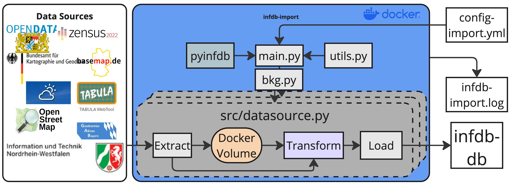
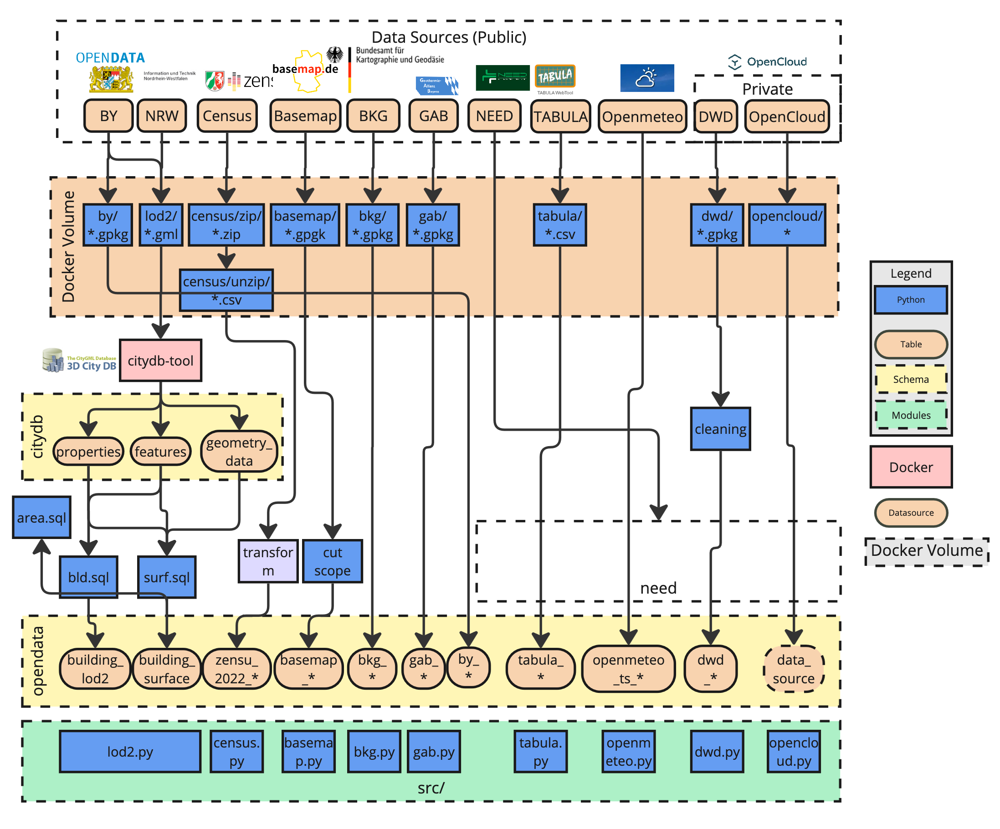

# infdb-import :material-cloud-download:

The **infdb-import** service facilitates the ingestion of external data into the InfDB platform. It automates the process of importing various open data formats, ensuring that new datasets are properly structured and integrated into the core database for immediate use.


## Architecture
The specialized microservice interacts directly with the InfDB database. It leverages containerization to ensure consistent deployment and operation across different environments. The service can be configured to connect to various data sources, retrieve datasets, and transform them into the required format for storage in the database.



## Supported Data Formats and Sources
The infdb-import supports a wide range of data formats and sources, including but not limited to:

- CSV files
- GeoJSON
- Shapefiles
- APIs from open data portals
- Remote databases

## Configuration

The configuration of the infdb-import service is controlled via environment variables:

```bash title=".env"
# ==============================================================================
# SERVICE ACTIVATION
# ==============================================================================
# Select profiles to activate
COMPOSE_PROFILES=...,opendata,...  # (1)

# ==============================================================================
# DATA IMPORTER AND LOADER (infdb-import)
# ==============================================================================
# Profile: opendata
# Path to the yaml configuration file for the infdb-import "configs/config-infdb-import.yml"
```

1.  **Activate service**: The `opendata` profile must be included in the list to activate the infdb-import service.

### YAML Configuration

The imported opendata sources are configured in a YAML file (default: `configs/config-infdb-import.yml`). This file controls which datasets are downloaded and processed.

Available data sources include (for North Rhine-Westphalia and Bavaria):

- Building data (LOD2)
- Statistical data (Zensus 2022, 2011)
- Building topology (TABULA)
- Weather and time series data (Openmeteo)
- Administrative areas (BKG)
- Postcodes (OpenStreetMap)
- Rooftop PV potential (Solarkataster NRW)

Example configuration structure:

```yaml title="configs/config-infdb-import.yml"
infdb-import:
    name: "project_name"
    scope:
        - "09162000"  # Municipality Key (AGS)
    config-infdb: "config-infdb.yml"

    # Database Connection (uses defaults if None)
    hosts:
        postgres:
            user: None
            password: None
            db: None
            host: None
            exposed_port: None
            epsg: None

    sources:
        zensus_2022:
            status: active
            save_local: not-active
            datasets:
                - name: Bevoelkerungszahl
                  status: active
                  table_name: bevoelkerungszahl
                  year: 2022
                  url: https://www.destatis.de/static/DE/zensus/gitterdaten/Zensus2022_Bevoelkerungszahl.zip
```

### Solarkataster NRW

The source `solarkataster-nrw` imports the rooftop PV potential of the Solarkataster NRW (state agency LANUK) for every NRW municipality (AGS `05...`) in `scope`. It is not active by default.

- **Data**: One record per roof surface with installable capacity (`kw`, kWp), module count, azimuth, tilt, specific yield and annual yield. LANUK derives it from an airborne laser scan surface model (0.5 m) and accounts for shading and roof structures.
- **Source**: [Open.NRW dataset "Solarkataster NRW: Potenzialdaten Dachflächen-Photovoltaik"](https://ckan.open.nrw/dataset/6b1af6af-cd03-4206-a323-894eae1aaf08), files per municipality on [opengeodata.nrw.de](https://www.opengeodata.nrw.de/produkte/umwelt_klima/energie/solarkataster/photovoltaik/) (`index.json`, dataset `Solarkataster-Potentiale-Photovoltaik_Shape`).
- **License**: [Datenlizenz Deutschland – Zero – Version 2.0](https://www.govdata.de/dl-de/zero-2-0) (dl-de/zero-2.0); no attribution required.

Tables (with the default `schema: opendata`, `prefix: solarkataster_nrw`):

| Table | Content |
|---|---|
| `opendata.solarkataster_nrw_pv_dach` | One row per roof surface. `objectid` is the ALKIS building ID (Shape field `name`) and equals `objectid` of the LoD2 buildings, e.g. `basedata.buildings.objectid`; `gemeindeschluessel` is the AGS (Shape field `gem_kn`). The other columns keep the Shape field names; see the column comments. |
| `opendata.solarkataster_nrw_import` | One row per imported municipality (`ags`, source file and its timestamp, import time, number of roof surfaces, total kWp). A building of a listed municipality without roof surface has no roof suited for PV. |

Each municipality is replaced in one transaction, so a rerun does not duplicate rows. Example: rooftop PV potential per building

```sql
SELECT b.objectid, COALESCE(SUM(p.kw), 0) AS pv_potential_kwp
FROM basedata.buildings b
JOIN opendata.solarkataster_nrw_import i ON i.ags = b.gemeindeschluessel
LEFT JOIN opendata.solarkataster_nrw_pv_dach p ON p.objectid = b.objectid
GROUP BY b.objectid;
```

## Data Storage
The downloaded and processed raw data files are stored in a dedicated volume within the Docker environment (`infdb-import-data`). This ensures persistence between runs while allowing easy removal without enhanced privileges.

## Developer Guide: Registering New Data Sources

### Prepare Development Environment
1.  Open `infdb-import` as a folder in your IDE.
2.  Ensure no `infdb-import` container is running (stop/remove if necessary).
3.  Open the folder in a VS Code Dev Container.
4.  In `main.py`, comment out the following lines to speed up development cycles (schema dropping and unnecessary sources):
    ```python
    # Drop schema "opendata" for clean development runs
    # with infdb.connect() as db:
    #       db.execute_query("DROP SCHEMA IF EXISTS opendata CASCADE;")
    ```
5.  Comment out specific data loading processes in `main.py` that you don't need for your current task.

### Registration Process

1.  **Create Script**: Create a new script in `src/` (e.g., `src/mydata.py`).
2.  **Implement Load Function**: Implement a `load(infdb: InfDB)` function.
3.  **Import**: In `main.py`, import your script:
    ```python
    from src import mydata
    ```
4.  **Add Process**: Add a new process to the `processes` list in `main.py`:
    ```python
    processes.append(mp.Process(target=mydata.load, args=(infdb,), name="mydata"))
    ```
5.  **Configure**: Add configuration parameters to `configs/config-infdb-import.yml`.

## License
The infdb-import service is released under Apache License 2.0, a permissive Open Source license that allows for wide usage and distribution with minimal restrictions. See the [LICENSE](https://www.apache.org/licenses/LICENSE-2.0) file for more details.
